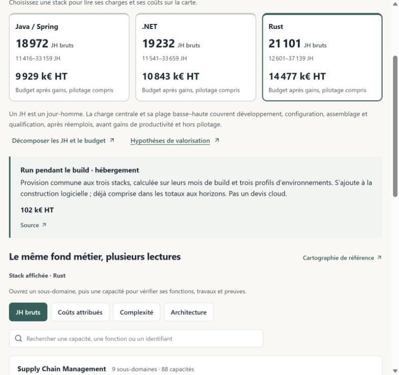

# Application du modèle composable — 27 octobre 2026

La référence finance désormais le scénario Groupe Make par activités. Elle distingue le cycle de vie du Core, l’intégration client, le Run, le MCO client et les évolutions client. Les financements Buy indivisibles sont conservés dans une colonne de responsabilité distincte. Le repère SAP retraité demeure un contrepoint ; il ne détermine plus le budget Make et ne s’y ajoute pas.

## Bases actives et traçabilité

- [Modèle composable](../source/modele-composable.yaml) : frontières, activités, objets financés et rattachements à la cartographie métier.
- [Déploiement Groupe](../source/deploiement-groupe.yaml) : volumes, quatre unités proposées, calendrier, pilotage et substitutions des anciens forfaits.
- [Calcul](../tools/composable_costs.py) : lecture des prix et activités sources, sans import des résultats d’audit.
- [Projection](../source/investissements-10-ans.yaml) : journal des financements, périodes, responsabilités, annuités et empreintes des entrées.
- [Proposition acceptée](2026-10-27-modele-composable.md) : justification détaillée et limites de preuve ; [référence précédente](../archives/modele-composable-2026-10-27/plan-investissement.yaml).

La cartographie explique les travaux concernés ; les moyens transverses ne sont pas répartis arbitrairement entre capacités. Les 43 situations guident la recette, sans multiplier les forfaits.

## Hébergement et frontières de financement

L’hébergement pendant les 48 mois de build représente **102 k€ HT par Make** : 12 mois à 1 k€ HT/mois, 24 mois à 2 k€ HT/mois, puis 12 mois à 3,5 k€ HT/mois. Il s’agit d’une provision d’ingénierie, pas d’une cotation fournisseur. Elle est distincte de l’outillage facturé par JH et varie avec la durée du build.

Le Run du build s’arrête quand commencent les moyens d’intégration. Le maintien du produit générique pendant l’intégration appartient au cycle du Core. Le MCO client commence après réception des adaptations, par cohorte ; les travaux avant réception restent dans l’intégration. Les annuités complètes prennent le relais à la stabilisation Groupe, au mois 82 de la référence. Aucun nouveau portefeuille d’évolutions n’est ajouté pendant la transition.

Les enveloppes initiales et transitoires sont évaluées aux prix de travail constants des sources. Les services annuels complets conservent ensuite les indexations existantes. Les durées simulées ajustent proportionnellement le calendrier des cohortes et de stabilisation. Le reste à financer comprend aussi l’hébergement et les services transitoires encore prévus.

Les activités mixtes MAI-005 et MAI-006 sont décomposées selon les hypothèses documentées. Les provisions de réception, respectivement 18 / 20 / 27 k€ HT pour Java / .NET / Rust, restent comprises dans l’enveloppe acceptée : leur classement n’ajoute aucun montant. Leur éventuelle inclusion contractuelle dans d’autres livrables reste à vérifier au cadrage.

## Résultats de référence

Dépenses cumulées en **k€ HT**, sans décimales à l’affichage ; calculs et rapprochements conservés au centime.

| Option | 3 ans | 5 ans | 7 ans | 10 ans |
|---|---:|---:|---:|---:|
| Make Java / Spring Boot | 7 507 | 11 316 | 14 340 | 17 703 |
| Make .NET | 8 192 | 12 318 | 15 556 | 19 223 |
| Make Rust | 10 918 | 16 244 | 20 239 | 25 352 |
| Buy Microsoft | 7 140 | 11 342 | 15 687 | 22 653 |
| Buy SAP | 18 111 | 23 709 | 29 619 | 39 108 |

L’intégration initiale Make représente désormais 2 775 / 2 940 / 3 356 k€ HT. Les écarts avec l’ancienne référence Make résultent du remplacement de l’hypothèse SAP par le chiffrage Groupe ; ils ne démontrent pas une économie commerciale. Les horizons courts n’offrent pas la même durée de service entre options : à cinq ans, le Make est encore en réalisation.

Les prix, séquences de facturation, annuités et quatre horizons Microsoft/SAP sont **strictement inchangés**. Aucune ventilation fournisseur du Core, du Run ou du MCO n’est inventée. Les montants connus hors contrat groupé sont distingués ; une part non ventilée n’est pas présentée comme gratuite. L’agrégat Buy peut réunir des prix groupés et des services client estimés, comme indiqué dans l’application.

Le catalogue `source/couts-15-ans.yaml` demeure une base de valorisation des activités et annuités, avec ses diagnostics historiques d’intégration. Le calendrier et les budgets actifs de l’application proviennent de `source/investissements-10-ans.yaml` et de l’adaptateur courant. Le classeur historique n’a pas été régénéré.

## Parcours et simulations

Le parcours expose les responsabilités, les trois périodes, le budget d’hébergement du build et les preuves de calcul. Les vues d’intégration, services annuels, synthèse, FAQ, comparaison et dépenses annuelles utilisent les résultats communs du moteur. L’agrégat technique historique `mco_run` est présenté comme « Services et abonnements » ; il ne désigne plus à lui seul le MCO client.

La migration accepte explicitement le contrat précédent connu. Elle conserve les paramètres modifiés de session, horizon, option choisie et nom. Les scénarios nommés et imports conservent leurs montants absolus, puis sont recalculés. Le bonus SAP sauvegardé reste une sensibilité du contrepoint SAP, sans modifier la nouvelle base Make. Les contrats inconnus restent protégés ; la restauration réussie reste silencieuse.

## Vérifications

- 51 tests Python couverts : moteur, API, lecture sponsor, financements, Buy, horizons et sensibilités. Le seul écart d’archive de build était d’un centime ; le contrôle historique utilise la tolérance de deux centimes, sans modifier le calcul actif. Après la finition des arrondis, les neuf tests de composition et séparation des coûts ont été rejoués avec succès.
- 31 tests JavaScript : reprise, scénarios nommés, ancien contrat réel, navigation et format monétaire.
- Compilation TypeScript, contrôle des contenus et build Vite réussis ; avertissement de taille du bundle conservé.
- Contrôles des sources générées : catalogue économique, projection et glossaire.
- Relecture navigateur : responsabilités, hébergement, détail Buy non ventilé, cinq colonnes et annuités, navigation et rechargement sans perte de session.

Les [preuves numériques](2026-10-27-modele-composable-application-preuves.json) rapprochent l’API active, la projection, les quatre horizons et les contrats de simulation. Le [jeu de migration](2026-10-27-modele-composable-migration-fixture.json) conserve uniquement les données nécessaires aux tests, extraites des deux réponses réelles de l’application.

