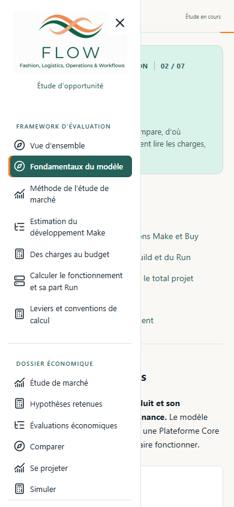

# Audit final du Framework d’évaluation

28 octobre 2026 — application publiée, commit `094a9354d3a0d7ae53a415fda036dcda4a85dafd`.

**Le parcours est logique et le framework présente désormais une méthode crédible, avec ses conditions et ses limites. Une nouvelle refonte n’est pas nécessaire.** Il reste des corrections ciblées de complétude, de séparation et d’accessibilité, puis deux finitions éditoriales. Aucune divergence arithmétique n’a été repérée dans les mécanismes examinés ; deux parties du calcul sont toutefois insuffisamment expliquées pour permettre une relecture complète.

Périmètre : les sept pages du **Framework d’évaluation**, leurs sommaires, formules, liens documentaires, glossaire associé et navigation commune. Le dossier économique est consulté uniquement pour contrôler la frontière et les renvois. L’audit n’évalue pas à nouveau les montants retenus ni leur calibration empirique.

## Ce qui est maintenant solide

- **La progression répond aux questions du lecteur** : pourquoi estimer au stade de l’opportunité, quels objets comparer, quelles preuves recueillir, quels travaux estimer, comment les valoriser, comment financer le fonctionnement, puis quelles hypothèses faire varier.
- **Synvance et la cartographie sont correctement positionnés comme entrants.** La cartographie structure Make et permet aussi de challenger Buy. Les observations de marché ne deviennent pas automatiquement des budgets.
- **Le contrat du skill est clair** : estimation des JH développeur bruts après réutilisation, tests développeur inclus, puis traitement distinct par le moteur. Les simulations n’appellent pas le skill.
- **Brut, net, charge totale projet et budget sont distingués.** La réutilisation ne reçoit pas une seconde remise. Les forfaits restent normalement en euros ; une provision budgétaire ne prouve pas une charge humaine dimensionnée.
- **Build et Run sont indépendants des phases et de la récurrence.** Le classement du MCO Core en Build est une convention explicite conforme au choix de l’utilisateur. La valeur de répartition du MCO Beaumanoir est bien située dans les hypothèses économiques.
- **Les limites renforcent la méthode** : inconnue distincte de zéro, financement unique, bornes non probabilistes, transposition nécessaire des références et distinction entre contrôle de cohérence et validation empirique.
- **Les chiffres sont présentés comme adaptables.** Les leviers du modèle sont distingués des seuls réglages disponibles directement dans Simuler.
- **La lecture continue fonctionne** : titres, gras, sommaires verticaux, sections espacées et formules visibles. Aucun bloc à déplier dans les sept pages. Le libellé ancien « Développeur et extensions » ne subsiste pas dans ce parcours.

## Corrections à effectuer avant de clore la revue

### 1 Compléter les formules de l’intégration Make

**Priorité P2 — Des charges au budget.** Le tableau explicite la coordination de la construction Core et le budget du programme, puis donne une consolidation générique. Il ne permet pas de reconstituer complètement le budget d’intégration Make.

Le moteur distingue les travaux communs et leur coordination, les déploiements et leur coordination propre, le programme, ainsi que les prestations partagées affectées à l’intégration avant réception. Le lecteur ne voit donc pas les deux assiettes de coordination ni tous les termes à rapprocher.

**Correction :** ajouter une décomposition courte de l’intégration Make, avec les deux assiettes et un renvoi vers le traitement des prestations avant réception. Vérifier la réconciliation avec le journal des financements ; ne pas présenter une formule de total qui omettrait ces prestations. Aucun coefficient actuel n’est nécessaire dans le Framework.

Preuves : [formules affichées](../source/methode-calcul-net.yaml#L142), [travaux et coordinations dans le moteur](../tools/composable_costs.py#L115), [prestations avant réception](../tools/composable_costs.py#L158).

### 2 Montrer le cycle Core pendant la transition

**Priorité P2 — Calculer le fonctionnement et sa part Run.** Le tableau « Services pendant la transition Make » présente deux fenêtres : service local après réception et service partagé depuis la première ouverture. Il manque le cycle Core, pourtant inclus dans le périmètre annoncé de la page.

Le moteur finance ses corrections et campagnes de qualification **dès le début de l’intégration**, pendant toute sa durée, avec leurs efforts unitaires, valorisation et coordination. Cette période ne se déduit pas des deux formules affichées.

**Correction :** ajouter cette troisième famille avec son assiette, ses ajustements applicables et sa période ; préciser quels services désigne « service partagé ». Conserver la distinction entre calcul du fonctionnement et classement Build/Run.

Preuves : [tableau de transition](../source/methode-calcul-run.yaml#L142), [cycle Core exécuté](../tools/composable_costs.py#L132).

### 3 Corriger deux points d’accessibilité

**Priorité P2 — Navigation commune, observée dans le Framework.** À 390 pixels, ouvrir la navigation au clavier laisse le focus sur le bouton d’ouverture désormais recouvert. La touche Tab poursuit dans le sommaire de la page derrière le panneau ; Échap ne ferme pas celui-ci.

**Correction :** déplacer le focus dans le menu à l’ouverture, gérer Échap et rendre le focus au déclencheur. Un panneau non modal peut fermer lorsque le clavier le quitte ; un piège de focus n’est pas nécessaire par défaut. Vérifier aussi le focus après choix d’une page.

Preuve : [gestion du menu](../app/src/App.tsx#L72). Le défaut concerne le menu mobile ; les sommaires internes et les fenêtres documentaires contrôlés gèrent correctement le focus.

**Le lecteur documentaire manque aussi d’un nom accessible.** Depuis la Vue d’ensemble, le lien vers les pièces Synvance ouvre un dialogue dont le titre visible est « Lire les propositions Synvance », mais l’arbre d’accessibilité n’annonce aucun nom pour ce dialogue. Relier le dialogue à son titre avec `aria-labelledby`. La fermeture et le retour de focus fonctionnent déjà.

Preuve : [composant Drawer](../app/src/components.tsx#L22) ; confirmation dans `tmp/framework-final-audit/confirmed.json`.

### 4 Transformer les constats Buy en règles conditionnelles

**Priorité P2 — Fondamentaux, Quels postes sont financés.** Deux phrases décrivent les offres actuelles comme une propriété générale du Buy : « En Buy, les parts correspondantes restent incluses dans les contrats sans ventilation connue » et « Les parts logiciel, cloud et maintenance ne sont pas connues séparément ».

Une offre future pourrait fournir cette ventilation. La seconde formulation existe aussi dans la définition canonique de « Licences et services ».

**Correction :** écrire une règle conditionnelle : lorsque le contrat regroupe les prestations, conserver son prix global ; les parts non documentées restent inconnues. Garder le constat sur les offres réellement examinées dans le dossier économique. Aligner description et glossaire dans la même correction.

Preuves : [MCO Core](../source/architecture.yaml#L100), [contrats groupés](../source/architecture.yaml#L159), [glossaire](../source/glossaire.yaml#L602), [rendu des cartes](../app/src/ModelPage.tsx#L48).

### 5 Définir les variables de la formule COCOMO

**Priorité P2 — Méthode de l’étude de marché.** La formule utilise `a` et `E`, puis demande de les exposer, sans expliquer leur signification. PNCLOC et les conventions horaires sont expliqués ; ces deux variables restent opaques.

**Correction :** définir `a` comme constante de productivité calibrée du modèle et `E` comme exposant décrivant l’effet de la taille sur l’effort. Ces rôles sont décrits par le [Software Engineering Institute](https://www.sei.cmu.edu/blog/software-cost-estimation-explained/). Conserver les coefficients choisis et les résultats du diagnostic dans le dossier économique.

La qualification « diagnostic nominal simplifié inspiré de COCOMO II » et les réserves sur sa transposition sont adéquates. Il s’agit d’expliciter la formule, sans accroître la portée de ce diagnostic ni le présenter comme une calibration FLOW.

Preuves : [formule et explication](../source/methode-evaluation-marche.yaml#L84), [calcul nominal](../tools/market_oss.py#L491).

## Finitions éditoriales

### 6 Annoncer le passage vers une analyse réalisée

**Priorité P3 — Fondamentaux.** Le lien « Examiner les écarts de périmètre des offres » ouvre une analyse contenant des conclusions sur le budget SAP repris dans l’étude. Le corps principal de la page reste méthodologique, mais le changement de statut n’est pas annoncé.

**Correction :** indiquer « Voir l’analyse des écarts dans le dossier économique », idéalement vers sa section. Conserver les accès aux pièces Synvance et à la cartographie comme entrants.

Preuves : [lien](../source/fondamentaux.yaml#L31), [analyse ouverte](../source/ecarts-perimetre-flow-rfi.md#L7).

### 7 Terminer l’harmonisation des libellés

**Priorité P3.** La Vue d’ensemble affiche « Consulter l’Méthode de l’étude de marché ». Écrire « Consulter la méthode de l’étude de marché », avec un libellé compatible avec le titre canonique. Dans les pages Make et Budget, remplacer « QA indépendante » et « tarif QA » par « qualification logicielle indépendante » et son tarif ; le terme clair est déjà utilisé ailleurs.

Preuves : [libellé de la Vue d’ensemble](../source/vision-framework.yaml#L77), [périmètre du skill](../source/methode-evaluation-core.yaml#L8), [tarif de qualification](../source/methode-calcul-net.yaml#L153).

## Couverture des sept pages

| Page | Bilan |
|---|---|
| Vue d’ensemble | Problématique, Make/Buy, entrants, paramètres adaptables et limites compréhensibles. Une faute de libellé. |
| Fondamentaux | Six chapitres cohérents. Descriptions Buy et destination du lien d’analyse à préciser. |
| Méthode de l’étude de marché | Preuves, normalisation, transposition et sorties bien distinguées. Variables COCOMO à définir. |
| Estimation du développement Make | Cinq étapes cohérentes avec le skill et son contrat. Acronyme QA à remplacer. |
| Des charges au budget | Brut/net, profils, total humain et euros correctement distingués. Intégration Make à détailler. |
| Calculer le fonctionnement et sa part Run | Unités, contrats, calendrier, indexation et tags explicites. Cycle Core transitoire à ajouter aux formules. |
| Leviers et conventions de calcul | Bonne synthèse des variables, invariants et conditions de comparaison ; pas de valeur actuelle réintroduite. |

## Vérifications et limites de cet audit

- Lecture du rendu public des sept pages à 1440 et 390 pixels ; confrontation aux sources, composants, modèle, deux skills et audits précédents.
- Aucun résultat chiffré cible identifié dans le corps principal du Framework. Les constantes nécessaires aux formules et les données d’entrée sont légitimes ; les deux descriptions Buy restent des constats actuels à reformuler.
- 35 destinations de sommaire atteintes au clavier avec focus sur le bon titre ; 15 tableaux nommés, avec en-têtes et défilement horizontal au clavier ; 11 formules visibles sans débordement. Aucun débordement de page à 320 ou 390 pixels. Documents Synvance et écarts consultables avec retour de focus ; PDF RFI accessible.
- Aucune erreur JavaScript ou HTTP relevée pendant ces parcours. Les animations décoratives sont désactivées avec la préférence de réduction des mouvements.
- Contrôle `check_model --content` réussi. Les mécanismes de valorisation, gains, expertise, indexation, répartition et normalisation examinés sont cohérents avec les explications affichées. L’audit ne remplace pas une validation empirique des hypothèses ni une certification exhaustive d’accessibilité.
- Relevés de travail : `tmp/framework-final-audit/rendered.json`, `ux-scan.json`, `interactions.json` et captures associées. Modèle servi : `57d2e719ef05f5a653e7df1f0fa2ed37a0a05f5f8cc5fa05e509d807d5a45c79`.

**Ordre recommandé :** compléter les deux passages de calcul, corriger le menu mobile et le nom accessible des lecteurs, rendre les descriptions Buy conditionnelles, définir les variables COCOMO, puis terminer liens et vocabulaire. Conserver le parcours et la présentation actuels.

Audit uniquement : aucune modification de l’application, des chiffres, des simulations, des skills ou du déploiement. Aucun commit ni push.
