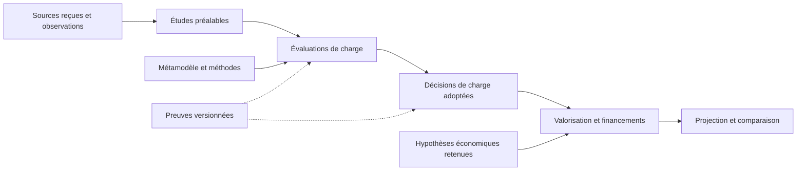

# Audit du modèle métier FLOW

Le modèle conserve une chaîne de calcul et des preuves identifiables. Sa structure mélange toutefois des observations de marché, des diagnostics de charge, des textes de lecture et des paramètres retenus. **Le nettoyage doit suivre le rôle des données, pas seulement les dossiers ou leur date.** La FAQ est retirée et une version lisible commune à l’application et au téléchargement est mise en place.

## Périmètre et preuves

L’inventaire couvre les **107 fichiers présents dans `source/` avant cette intervention**, le chargement de `valuation()`, celui de `Study()`, la sélection de l’export métier et la liste des documents publiables. Les originaux et preuves situés dans `sources/`, `audits/` et `archives/` sont examinés par leurs dépendances, sans balayage des dépôts OSS complets.

| Contrôle avant nettoyage | Fichiers de `source/` concernés | Ce que le contrôle établit |
| --- | ---: | --- |
| Chargement économique `valuation()` | 45 | Dépendances lues pour valoriser les travaux et les services |
| Chargement complet de l’application `Study()` | 94 | Données métier, contrôles et lectures documentaires chargés ensemble |
| Présence dans le téléchargement métier | 89 | Sources retenues par la fermeture de dépendances de l’export |

Ces ensembles se recouvrent. Le téléchargement contient **189 pièces structurées au total**, dont des sources extérieures à `source/`. Une référence textuelle prouve un lien, pas l’exécution d’un champ. Un fichier absent de `valuation()` peut rester une preuve indispensable à une décision adoptée. Les [inventaires avant](inventory-before.json) et [après](inventory-after.json) conservent les chemins, les empreintes et les usages observés.

## Les études préalables portent encore des calculs de charge

**Oui, au niveau des données et de leur compilation.** La lecture actuelle de la comparaison des solutions masque déjà les résultats de charge, mais le registre `source/references-couts-integration.yaml` conserve plusieurs rôles.

| Partie du registre | Nature réelle | Classement logique |
| --- | --- | --- |
| `reperes_build_core.etude_oss.mesure` | Versions, composants et mesures du code sélectionné | Observations logicielles en entrée |
| `etude_oss.methode` et `etude_oss.calcul_cocomo` | Paramètres et sélection d’un ancien diagnostic de reconstruction | Diagnostic de charge séparé |
| `references[*].cout_publie` et `normalisation_2026` | Prix publiés avec leurs conversions et limites | Études préalables |
| `references[*].transposition_au_perimetre_flow_beaumanoir` | Application proposée au périmètre FLOW, parfois non chiffrée | Évaluation et dossier économique |
| `fiches_produit`, rapprochements et preuves fonctionnelles | Fonctions observées et comparaison au besoin | Études préalables, avec séparation des résultats d’estimation |

Le diagnostic COCOMO global est encore exécuté par `tools/market_oss.py`. Il produit **44 301 JH** dans le chargement contrôlé. **Ce résultat n’est pas le budget de construction FLOW adopté.** Le registre n’est pas une dépendance directe de `valuation()` dans la fermeture observée. Des sélections et mesures qu’il porte sont néanmoins utilisées par les lectures de méthode et de qualification. Retirer tout le bloc sans les séparer casserait ces usages.

À l’inverse, les cohortes ISBSG, les mesures de productivité et les charges publiées de projets sont des entrants légitimes. `preetude-couts-marche.yaml#effort_groups` sélectionne ces repères. Le module `tools/prestudy_costs.py` n’applique pas les prix retenus pour valoriser des travaux FLOW. **Une charge observée dans une référence est une entrée. Une charge calculée pour FLOW est une évaluation.**

## Le téléchargement suit le chargement de l’application

**Priorité haute.** `tools/export_business_model.py#compose` sélectionne les documents structurés chargés dans `SourceSnapshot`, selon leur chemin et leur extension. Cette fermeture préserve les preuves, mais elle n’identifie pas à elle seule les données métier actives.

La FAQ en était un exemple concret : inutilisée par le parcours React, elle était encore compilée par `Study._faq()`, déclarée publiable et intégrée au téléchargement métier. D’autres fichiers de lecture, comme `vision-framework.yaml`, `lecture-evaluations-economiques.yaml`, `synthese-sponsor.yaml` et `telechargements.yaml`, restent chargés ou exportés sans être des paramètres économiques.

Il faut conserver la fermeture de preuve et lui ajouter une **classification explicite du rôle et du cycle de vie**. L’export doit distinguer données actives, observations, méthodes, décisions, diagnostics, lectures et preuves historiques utilisées. Déplacer les textes d’une page ne suffit pas à faire évoluer cette structure.

## Ce qui est actuel, historique ou obsolète

| Ensemble | Constat | Traitement |
| --- | --- | --- |
| FAQ YAML, adresse documentaire et composant React | Aucun usage dans le parcours courant, mais compilation et export encore actifs | Retirés. Copies exactes conservées dans l’archive de retrait |
| Passage du guide annonçant une construction Java à zéro | Contredit les décisions professionnelles Java/Spring adoptées | Corrigé avec renvoi aux propriétaires des décisions et du statut |
| Définition du Build limitée aux trois options Make | Description dépassée pour le parcours actuel | Reformulée sans nombre d’options, puis glossaire Markdown régénéré |
| Anciennes mentions de Simuler et des cinq options dans les lectures historiques | Restes du précédent parcours, notamment dans `lecture-evaluations-economiques.yaml` et `synthese-sponsor.yaml` | À isoler des lectures courantes lors de la séparation des contenus |
| `evaluation-core.yaml` | Hors du chargement et de l’export actuels, encore référencé par l’outil de qualification | Pièce d’outillage historique, pas un fichier orphelin démontré |
| `grille-complexite.yaml`, `methode-complexite.yaml`, `recalibration-metier.yaml` | Hors du chargement et de l’export actuels, références encore présentes dans les anciens outils et vues | Candidats à un archivage coordonné de l’ancien mécanisme, après reprise des liens nécessaires |
| `diagnostics/calibration-historique.yaml` | Hors calcul courant et export métier, encore publiable | Conserver comme diagnostic identifié, revoir sa place dans la publication |
| `investissements-10-ans.yaml`, `investissements-15-ans.yaml`, `couts-15-ans.yaml` | Résultats stockés, hors de la fermeture de calcul observée | Ne pas présenter comme paramètres. Dater et identifier leur version, puis conserver ou archiver selon les liens historiques |
| Paramètres .NET et Rust | Masqués du parcours courant, conservés par les calculs et contrats historiques | Ne pas supprimer comme données inutilisées |
| Pièces fournisseur, captures et preuves de calcul datées | Certaines restent des dépendances actives | Préserver les originaux, leurs empreintes et leurs références |

Aucun autre retrait automatique n’est justifié par le seul inventaire. **Non affiché, non calculant, historique et inutile sont quatre situations différentes.**

## Structure logique recommandée

| Famille | Contenu et propriétaires actuels |
| --- | --- |
| Référentiels et sources reçues | Cartographie native, pièces RFI et registres de provenance |
| Études préalables | Fonctions observées, mesures de code, références de projets, tarifs observés et indices documentés |
| Métamodèle et méthodes | `fondamentaux.yaml`, schémas, règles de calcul et méthodes de transposition |
| Évaluations de charge | `calculs-estimation-core.yaml`, calculs par unité, activités d’intégration et de maintenance, hypothèses de dimensionnement |
| Décisions adoptées | `estimations-core-retenues.yaml`, liens vers les calculs et périmètres retenus |
| Hypothèses économiques et financements | Tarifs retenus, provisions, calendrier, services, achats, journal composable et conventions de projection |
| Résultats | Budgets, annuités et horizons générés depuis les mêmes financements |
| Preuves et historique | Pièces originales et calculs figés encore utilisés, diagnostics distincts des décisions actives |
| Lecture et publication | Textes des pages, navigation, catalogue des téléchargements et composition des livraisons |

Cette première réorganisation peut conserver les chemins actuels et ajouter un index logique. Une migration physique ultérieure doit reprendre les références et les preuves par empreinte, sans recalibrer les JH ou les coûts. Elle ne doit pas faire dupliquer une donnée entre la préétude et l’évaluation.

## Nettoyage appliqué et suite proposée

Le retrait de la FAQ couvre le chargement, l’export, la publication, les téléchargements, les métadonnées de navigation et ses styles inutilisés. L’[archive réversible](../../archives/retrait-faq-2026-11-01/receipt.json) conserve les trois fichiers retirés et leurs empreintes. L’ancienne adresse `#faq` mène aux fondamentaux.

La version lisible est **01/11/2026 — n° 1**. Son propriétaire est `source/version-modele.yaml`. Le compteur est global, ne se remet pas à zéro à chaque date et n’augmente pas lors d’un rechargement ou d’une reconstruction. La commande `python -m tools.model_revision bump --date AAAA-MM-JJ` crée explicitement la version suivante. L’application, l’export métier et les instantanés partagent cette identité. Les empreintes techniques restent séparées pour protéger les calculs et les anciennes sauvegardes.

La suite prioritaire consiste à séparer les observations du registre de marché de son diagnostic COCOMO et de ses transpositions FLOW, puis à classer explicitement le contenu du téléchargement. L’archivage coordonné des anciens mécanismes vient ensuite. **Les paramètres, décisions, budgets et contrats de simulation restent inchangés dans cette intervention.**

## Contrôles de livraison

Les 376 tests Python sélectionnés, le typage, les tests de l’interface et les contrôles éditoriaux sont passés. Les vues ordinateur et mobile présentent la même version, sans débordement horizontal. Le téléchargement réel a été vérifié par empreinte et par contenu. Les résultats économiques des cinq options et le contrat des sauvegardes sont strictement identiques au témoin initial. Le [reçu de vérification](verification.json) et la [validation détaillée](validation.json) conservent les contrôles et leur portée.
